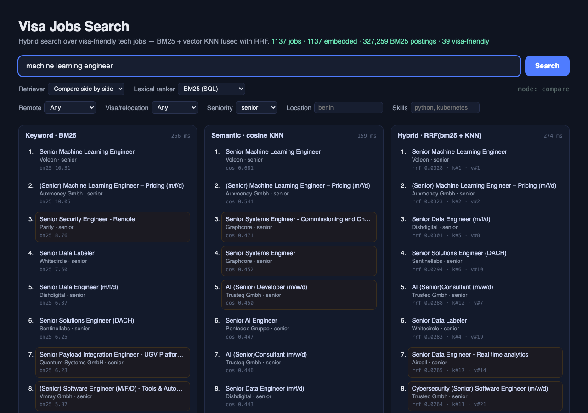
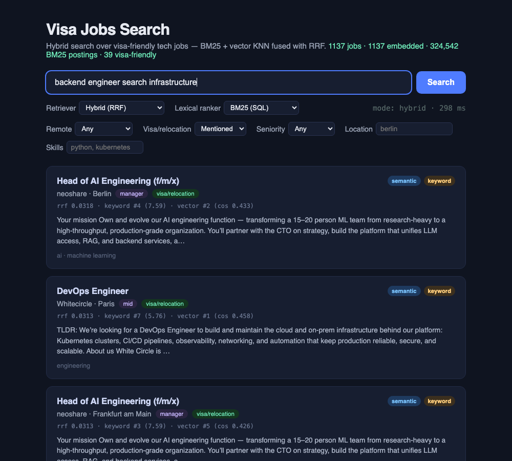

# Visa Jobs — Hybrid Search Engine 🛂🔍

An event-driven **hybrid job search engine** for visa-friendly tech jobs — BM25 implemented in SQL, pgvector KNN, Reciprocal Rank Fusion, structured filters pushed into every retriever, a side-by-side retriever comparison, and an offline relevance eval (P@K / R@K / MRR / nDCG). Plus an autonomous [Claude Agent SDK](https://code.claude.com/docs/en/agent-sdk/quickstart) digest agent. One `docker compose up` runs the whole thing.

```
                    ┌─────────────────────────────────────────────────────┐
                    │                   docker compose                     │
                    │                                                      │
 arbeitnow API ───▶ │  ingester ──── new job rows ────▶ Postgres+pgvector  │
                    │      │                                ▲    ▲         │
                    │      │ "job.created" event            │    │         │
                    │      ▼                                │    │         │
                    │  SQS queue (ElasticMQ) ──▶ indexer ───┘    │         │
                    │                     embeds w/ MiniLM       │         │
                    │                                            │         │
 browser ◀────────▶ │  React UI ◀── api (BM25 | KNN | RRF hybrid) ┘         │
                    └─────────────────────────────────────────────────────┘

 (separate) GitHub Actions cron ──▶ digest agent (Claude Agent SDK) ──▶ digests/*.md
```



*The compare view runs one query through all three retrievers. Highlighted rows appear in only one column — the cases where retriever choice changes what the user sees. Every result carries its rank and raw score in each retriever.*

## What it demonstrates

- **Event-driven architecture** — the ingester publishes a `job.created` message per new job to an SQS queue; the indexer consumes and embeds asynchronously. Uses the real `@aws-sdk/client-sqs` against [ElasticMQ](https://github.com/softwaremill/elasticmq), so pointing `SQS_ENDPOINT` at real AWS SQS is the only change needed for production.
- **Reconciliation over blind trust** — queues are at-least-once and consumers crash; a reconciler re-queues any job still unindexed after 5 minutes. Indexing is idempotent, so duplicates are harmless.
- **BM25 in plain SQL** — Postgres' `ts_rank` is not BM25 (no IDF, no length normalisation). A trigger maintains an inverted index (`job_terms`: job, lexeme, field-weighted tf) from the same `tsvector`, and `bm25Cte()` computes the textbook formula with `k1 = 1.2`, `b = 0.75`. Both rankers are exposed so you can compare them on identical tokens.
- **Three retrieval modes, one SQL round-trip** — `mode=keyword|semantic|hybrid`. Hybrid fuses BM25 and pgvector cosine KNN with Reciprocal Rank Fusion. Every result reports its rank and raw score in each retriever, so you can see *why* it ranked.
- **Filters pushed into the retrievers** — `remote`, `visa`, `location`, `skills` (tag or text, all required) and `seniority` (derived at ingest from the title) are applied inside each candidate query, not after fusion. Post-filtering a top-60 list returns almost nothing once a filter is selective.
- **Compare view + offline eval** — the UI shows BM25, semantic and hybrid side by side and highlights results unique to one retriever. `npm run eval` scores five configurations on 16 queries with P@10, R@10, MRR, nDCG@10 and latency, so ranking changes are measured rather than eyeballed. See [docs/SEARCH-NOTES.md](docs/SEARCH-NOTES.md) for the results and what they taught me.
- **Local embeddings** — `all-MiniLM-L6-v2` (384-dim) via Transformers.js, running on CPU inside the containers. No API keys, no external calls; the model is cached in a shared Docker volume.
- **Agentic automation** — the original digest agent (in `agent/`) still runs twice a week via GitHub Actions, using Claude's `WebSearch`/`WebFetch` to hand-curate visa-sponsored roles into markdown digests.

## Run it

```bash
docker compose up --build
# UI + API on http://localhost:8080  (override with API_PORT=8090 docker compose up)
```

First start downloads the embedding model (~90 MB, cached in a volume). Within a minute or two the ingester pulls ~400 jobs, fans them through the queue, and the indexer embeds them. Watch it happen:

```bash
docker compose logs -f ingester indexer
curl localhost:8080/api/stats
```

Try a semantic query — no keyword overlap required — then the same query through each retriever:

```bash
curl "localhost:8080/api/search?q=backend+engineer+search+infrastructure&visa=true"
curl "localhost:8080/api/search?q=backend+engineer+search+infrastructure&mode=keyword&lexical=bm25"
curl "localhost:8080/api/search?q=backend+engineer+search+infrastructure&mode=keyword&lexical=ts_rank"
curl "localhost:8080/api/search?q=backend+engineer+search+infrastructure&mode=semantic"
curl "localhost:8080/api/compare?q=machine+learning+engineer&seniority=senior,lead&location=berlin"
```

Measure relevance across configurations:

```bash
docker compose exec api npm run eval              # summary table
docker compose exec api npm run eval -- --verbose # per-query breakdown
```

**Upgrading an existing database** — `init.sql` only runs on an empty volume. It is idempotent, so apply it to a running instance and it adds the new columns, builds the BM25 index and backfills:

```bash
docker compose exec -T db psql -U jobs -d jobs < db/init.sql
```



*Hybrid mode with the visa filter. Each card explains its rank: RRF total, BM25 rank and points, vector rank and cosine similarity.*

## Services

| Service | Path | Role |
|---|---|---|
| `ingester` | `services/ingester` | Polls the arbeitnow job API, dedupes into Postgres, publishes `job.created` events, reconciles missed indexing |
| `indexer` | `services/indexer` | Long-polls SQS, embeds jobs with MiniLM, writes vectors to pgvector |
| `api` | `services/api` | Search (BM25 / ts_rank / KNN / RRF hybrid), compare, stats, eval script, serves the UI |
| `web` | `web` | React + Vite search UI: retriever switch, filters, compare view, per-result ranking explanation |
| `agent` | `agent` | Claude Agent SDK digest agent (scheduled via GitHub Actions) |

## API

| Endpoint | Description |
|---|---|
| `GET /api/search?q=...` | Search; without `q` returns newest jobs (filters still apply) |
| `GET /api/compare?q=...` | Same query through keyword, semantic and hybrid — one embedding, three ranked lists with timings |
| `GET /api/stats` | Corpus counts, seniority breakdown, BM25 posting count, last ingest time |

Search parameters:

| Param | Values | Notes |
|---|---|---|
| `mode` | `hybrid` (default), `keyword`, `semantic` | |
| `lexical` | `bm25` (default), `ts_rank` | Which lexical ranker keyword/hybrid use |
| `remote`, `visa` | `true`, `false` | |
| `location` | substring, e.g. `berlin` | Case-insensitive |
| `skills` | comma list, e.g. `python,kubernetes` | Every skill must appear as a tag or in title/description |
| `seniority` | comma list of `intern,junior,mid,senior,lead,principal,manager` | Derived from the title at ingest |
| `limit` | ≤ 50 | |

Each result carries `score` (RRF in hybrid, otherwise the retriever's own score), `keyword_rank` / `keyword_score`, `semantic_rank` / `cosine_similarity`, and `keyword_hit` / `semantic_hit`.

## Documentation

- [docs/ARCHITECTURE.md](docs/ARCHITECTURE.md) — event flow, hybrid search internals, filter pushdown, failure handling, the reconciler, and a debugging war story about silently vanishing queue messages.
- [docs/SEARCH-NOTES.md](docs/SEARCH-NOTES.md) — BM25, embeddings, cosine similarity and RRF explained with the formulas, where each lives in the code, eval results, and what they taught me (including why a naive BM25 lost to `ts_rank`).

## Why this stack?

Every choice here optimizes for the same thing: **the smallest system that demonstrates the real production patterns** — event-driven indexing, hybrid retrieval, failure recovery — with zero external accounts and one `docker compose up`.

### Postgres + pgvector, not Elasticsearch

I use Elasticsearch professionally (KNN + BM25 hybrid search over millions of candidate profiles), so this was a deliberate trade, not unfamiliarity:

- **Right-sized.** ES wants ~1 GB of heap before it says hello. For a 400–100k document corpus, `tsvector` (weighted BM25-style ranking) + pgvector's HNSW index cover both retrievers in one ~50 MB container.
- **One source of truth.** Raw rows, full-text index, and vectors live in the same table — the FTS index updates transactionally with the insert, so there's no dual-write/sync problem between a database and a search cluster. In production systems that sync *is* the hard part (it's exactly what the SQS pipeline here handles for the vector side).
- **The architecture doesn't lock you in.** The indexing contract is "consume `job.created`, write to the index." Swapping Postgres for Elasticsearch changes the indexer's write target and the API's query — the ingester, queue, event schema, and reconciler are untouched. That boundary is the point of the design.
- **When I'd switch:** corpus in the millions, heavy faceting/aggregations, per-field relevance tuning (analyzers, synonyms, function scores), or index-time sharding — that's ES territory.

### ElasticMQ, not real SQS / LocalStack / Kafka / Redis

- **Real SQS** needs an AWS account — a hard "no" for a repo strangers should be able to run. ElasticMQ speaks the SQS wire protocol, so the services use the production `@aws-sdk/client-sqs`, and deploying against real SQS is a one-env-var change (`SQS_ENDPOINT`). The code you review is the code that would ship.
- **LocalStack** emulates all of AWS; I only need a queue. ElasticMQ is a single-purpose ~40 MB image that starts in about a second.
- **Kafka** is for streams: replay, ordering, many consumer groups, retention. This is a work queue — each message processed once, then gone. SQS semantics (visibility timeout, at-least-once) match the job, and a queue you drain is simpler to reason about than an offset you rewind.
- **Redis/BullMQ** would work, but demonstrates a Redis-specific API. The AWS SDK integration is the more transferable pattern.

### Local embeddings (Transformers.js + MiniLM), not an embeddings API

- **Zero keys, zero cost, works offline** — anyone can clone and run without signing up for anything. An API-key requirement kills a demo repo.
- `all-MiniLM-L6-v2` is 384-dim, ~90 MB, and embeds a job post in ~100 ms on CPU. For short semi-structured text like job posts, bigger models buy little extra relevance.
- Runs **in-process in Node** — no Python sidecar, no inference server, one less container.
- **Trade-off:** a hosted or larger model wins on multilingual nuance — visible here since arbeitnow skews German. The embedding call is one function; swapping it is a 5-line change.

### A queue at all, not just "embed on insert"

The ingester could call the embedder directly — at 400 jobs that would even be simpler. The queue exists because it's the pattern that survives scale: ingestion and indexing scale independently (embedding is CPU-bound — run N indexers; visibility timeouts already make that safe), a burst of 10k jobs degrades into a backlog instead of an outage, and an indexer crash loses nothing. The reconciler then covers the queue's own failure modes — see [docs/ARCHITECTURE.md](docs/ARCHITECTURE.md) for the bug that proved it necessary.

### The boring choices

- **TypeScript everywhere** — one language across three services and the frontend; strict mode catches contract drift between them.
- **Express** — the API is two endpoints; a more opinionated framework would be more to read, not more to learn from.
- **React + Vite** — the UI's job is to make `semantic_hit` vs `keyword_hit` visible, not to be clever.
- **Docker Compose** — the whole pipeline is one command. Reviewers don't read setup docs; Kubernetes here would demonstrate ops, not search.

### Other notes

- **Why RRF for fusion?** Rank-based fusion needs no score normalization between BM25 points and cosine distances — the two retrievers never have to agree on what a "good score" is. `score = Σ 1/(60 + rank_i)`. A consequence worth knowing: a document both retrievers rank mid-list beats one that a single retriever ranks #1.
- **Why implement BM25 by hand when `ts_rank` exists?** To be able to compare them on identical tokens and to understand what each term in the formula does. The eval then showed `ts_rank`'s field weights mattered more than BM25's IDF on this corpus — which is how the BM25 index became field-weighted (BM25F-style). Details in [docs/SEARCH-NOTES.md](docs/SEARCH-NOTES.md).
- **Why detect visa support by keywords at ingest?** The source API has no visa flag. A regex over title/tags/description marks explicit mentions cheaply at write time; semantic search catches implicit ones at query time.

## Roadmap

Next layers of a production ranking stack, in the order I plan to add them:

1. **Cross-encoder re-ranking** of the fused top 50 (a small local reranker via Transformers.js), measured with the same eval.
2. **Learning to rank** — swap the heuristic judgments for click/apply signals and train a LambdaMART model over BM25, cosine, recency and filter-match features (I run this pipeline on Elasticsearch professionally; here it would be pure Postgres).
3. **Job recommendations** — "similar jobs" from the existing vectors, then a user profile vector from saved/applied jobs.
4. **Multilingual embeddings** — the corpus skews German and MiniLM is English-only.

## Digest agent (the original project)

Lives in `agent/` — an autonomous researcher that scans job boards for visa-sponsored roles matching `agent/jobs.config.json` and writes verified markdown digests. Runs Mon/Thu via `.github/workflows/digest.yml` (needs an `ANTHROPIC_API_KEY` repo secret). Locally: `cd agent && npm run digest`.

## License

MIT
